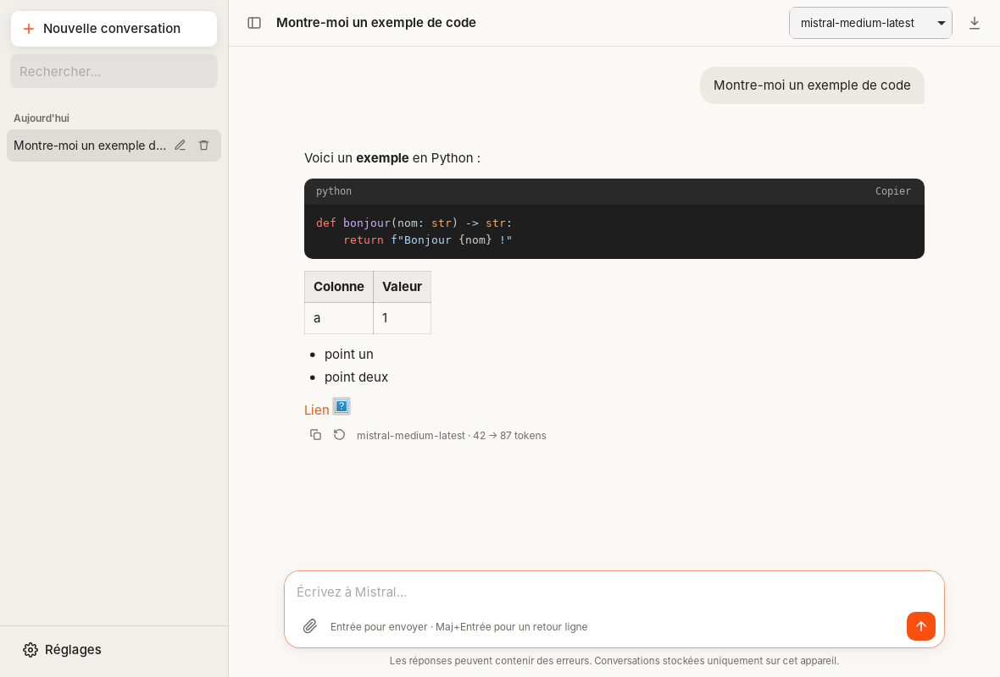
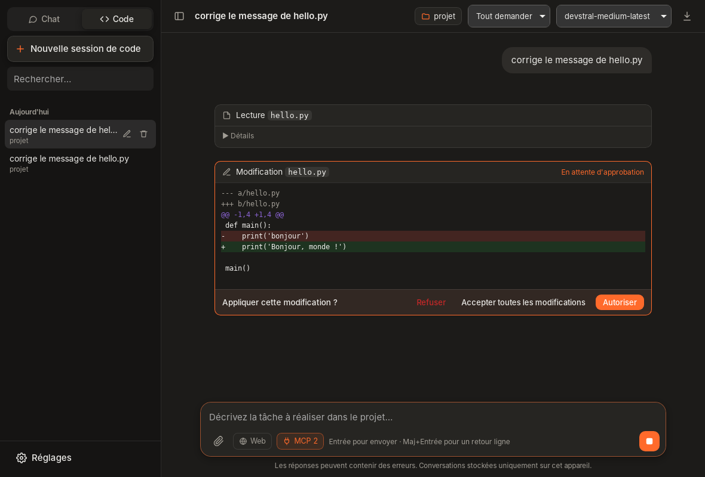
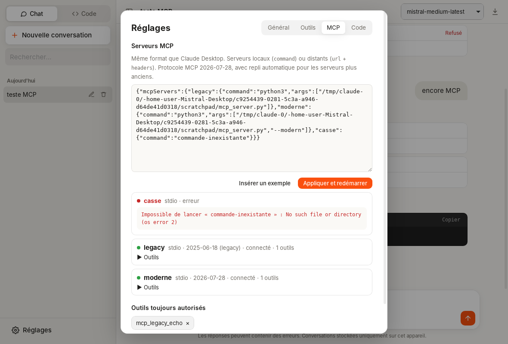

# Mistral Desktop

Client de bureau **léger, open source et sans télémétrie** pour l'API [Mistral AI](https://mistral.ai), dans l'esprit de Claude Desktop : chat, **agent de code**, **recherche web**, **PDF** et **serveurs MCP**. macOS, Windows et Linux.

> Projet indépendant, non affilié à Mistral AI.



## Fonctionnalités

### Chat
- Réponses en **streaming**, arrêt à tout moment (bouton ■ ou `Échap`)
- Rendu **Markdown** : tableaux, listes, blocs de code colorés avec bouton « Copier »
- **Raisonnement** des modèles Magistral dans un bloc repliable
- Pièces jointes : **images** (modèles vision), **PDF** et **fichiers texte/code**, par bouton, glisser-déposer ou collage
- Historique local : **recherche plein texte** (titres et contenu des messages, insensible aux accents, extrait surligné), renommage, suppression, regroupement par date ; modifier un message, régénérer une réponse
- Choix du modèle par conversation, instructions système, température, tokens max, **export Markdown**

### Projets
Comme dans Claude Desktop : des conversations regroupées qui partagent des **consignes** et des **fichiers de référence** (texte, Markdown, code, CSV, PDF).
- Sélecteur en haut de la barre latérale : filtre les conversations ; les nouvelles conversations sont rattachées au projet affiché
- **Dossier de travail** du projet : dossier local ou dossier d'un **serveur SSH**. Les sessions de code du projet s'y ouvrent directement (en mode Code, « Nouveau projet » propose le dossier ouvert)
- Une conversation peut changer de projet à tout moment (menu en haut de la fenêtre)
- Consignes et fichiers sont ajoutés à l'invite système de chaque message du projet (estimation du nombre de tokens affichée) ; tout est stocké localement dans `projects/`
- **Gros projets** (au-delà de 60 000 caractères, jusqu'à 10 millions) : recherche locale BM25 par extraits. Seuls les passages pertinents pour la question sont envoyés (≈ 4 k tokens par message), et le modèle dispose d'un outil `search_project_files` pour chercher d'autres passages. Aucun index ni embedding ne quitte la machine

### Dictée vocale
Bouton micro dans la zone de saisie (`Ctrl/⌘+Maj+D`, `Échap` pour annuler) : capture native du micro, transcription par **Voxtral 3** (`voxtral-mini-transcribe-3-0` par défaut, ou `voxtral-small-transcribe-3-0`, plus précis), texte inséré au curseur.
- Si le modèle est refusé par l'API, repli automatique sur Voxtral 2 (`voxtral-mini-latest`), avec un message
- **Vocabulaire personnalisé** (noms propres, termes techniques : Proxmox, fail2ban…) transmis comme biais de contexte
- Le son reste **en mémoire** (WAV mono 16 kHz, jamais écrit sur le disque), 15 min max
- Langue configurable (français par défaut) ou détection automatique
- **Serveur de transcription auto-hébergé** possible (toute API compatible `/v1/audio/transcriptions` : Voxtral via vLLM, Speaches/faster-whisper…) ; la clé Mistral n'est alors jamais transmise

### Recherche web
Bascule **Web** dans la zone de saisie. Le modèle dispose alors de `web_search` et `fetch_url` et cite ses sources.
- Fournisseur **Mistral** (connecteur `web_search` de l'API Conversations) ou **SearXNG** auto-hébergé
- `fetch_url` lit les pages depuis votre machine ; les adresses du réseau local (routeur, NAS, 10.x, 192.168.x…) sont **bloquées** pour éviter qu'une page piégée ne fasse sonder votre LAN au modèle

### PDF
- **Auto** (défaut) : extraction locale du texte ; bascule sur l'**OCR Mistral** (`mistral-ocr-latest`) seulement si le PDF est scanné
- **Locale** uniquement (rien n'est envoyé pour la conversion) ou **OCR** systématique (tableaux, mises en page complexes)

### Agent de code (onglet **Code**)



Un agent façon Claude Code, propulsé par Devstral, travaille dans un dossier de votre machine :
- Outils : `list_files`, `read_file`, `search_files` (regex, respecte `.gitignore`), `edit_file` (remplacement exact), `write_file`, `run_command`
- **Diff coloré** avant chaque modification, approbation commande par commande
- Trois niveaux de permission par session : **Tout demander**, **Modifs auto** (les commandes restent soumises à approbation), **Autonome**
- Chaque nouvelle session commence par le **choix du dossier** : dossier local ou dossier d'un serveur SSH, depuis l'écran d'accueil ou le bouton dossier de la zone de saisie (dossiers récents en un clic)
- **Accès système** (bouton « Système » de la zone de saisie, désactivé par défaut) : l'agent peut lire et modifier des fichiers hors du projet en chemin absolu, par ex. `/etc/fail2ban/jail.local` sur un serveur SSH. Chaque écriture hors projet est soumise à approbation avec son diff (sauf en mode Autonome), les lectures aussi en mode « Tout demander ». Les fichiers réservés à root nécessitent une connexion avec les droits suffisants (pas d'élévation via sudo)
- Accès **confiné au dossier choisi** via la boîte de dialogue native (chemins `..`, absolus et liens symboliques vers l'extérieur refusés)
- Commandes non interactives, avec délai max configurable ; l'arrêt tue tout l'arbre de processus
- **Fichiers de consignes** : `AGENTS.md` (standard ouvert), `MISTRAL.md` ou `CLAUDE.md` à la racine du projet sont lus automatiquement à chaque tâche, en local comme en SSH (indicateur dans la barre du haut). S'il n'y en a pas, l'agent peut le générer en analysant le dépôt
- **Shell** : bash sous macOS/Linux. Sous Windows, **Git Bash** s'il est installé (les modèles écrivent naturellement du bash), sinon PowerShell 7, sinon Windows PowerShell 5.1 ; l'agent reçoit des consignes adaptées au shell détecté. Choix manuel dans Réglages → Code. Recommandé : installer [Git pour Windows](https://git-scm.com/download/win)

### Serveurs SSH distants

Dans l'onglet **Code** → **Serveur SSH…**, l'agent travaille directement sur un serveur : lecture, recherche (ripgrep ou grep), édition de fichiers, commandes et git s'exécutent à distance.
- Utilise le **client OpenSSH du système** : alias, `ProxyJump`, clés et options de `~/.ssh/config` s'appliquent comme dans un terminal ; authentification par **agent SSH ou clé** (pas de mot de passe, jamais d'invite bloquante)
- **Hôte inconnu** : les empreintes SHA256 sont affichées avant toute confiance, puis ajoutées à `~/.ssh/known_hosts` ; une clé d'hôte modifiée est signalée
- Connexions réutilisées (ControlMaster) sous macOS/Linux pour des outils rapides
- Navigation dans les dossiers distants pour choisir le projet ; accès confiné à ce dossier pour les outils de fichiers
- Arrêt fiable : le groupe de processus distant est tué (TERM puis KILL) quand vous arrêtez une commande
- Le modèle sait qu'il opère sur un serveur distant (système détecté) et est invité à la prudence (services, configuration, données)

### Git

Bouton **⎇** dans la barre du haut (ou `Ctrl/⌘+G`), en local comme en SSH :
- branche courante, avance/retard sur la branche distante, changement et création de branche
- fichiers modifiés / indexés / nouveaux, **diff** coloré au clic, indexer / retirer / annuler (double clic)
- **commit** avec message **généré par le modèle** à partir du diff indexé (Conventional Commits, langue des commits précédents)
- récupérer / tirer (`--ff-only`) / pousser (crée la branche distante si besoin), historique des 20 derniers commits
- l'agent dispose d'outils `git_status`, `git_diff` et `git_log` en lecture seule (sans approbation) ; commit et push restent sur votre demande

### Serveurs MCP



Configuration au **format de Claude Desktop** (Réglages → MCP) :

```json
{
  "mcpServers": {
    "fichiers": {
      "command": "npx",
      "args": ["-y", "@modelcontextprotocol/server-filesystem", "/home/moi/Documents"]
    },
    "distant": {
      "url": "https://mcp.example.org/mcp",
      "headers": { "Authorization": "Bearer JETON" }
    }
  }
}
```

- Transports **stdio** et **Streamable HTTP**
- Protocole **MCP 2026-07-28** (sans état) avec **repli automatique** sur la poignée de main `initialize` pour les serveurs plus anciens (≤ 2025-11-25)
- Chaque appel demande votre accord, avec « Toujours autoriser cet outil » ; bascule **MCP** pour désactiver les outils dans une conversation
- Sous macOS/Linux, le `PATH` de votre shell est récupéré au démarrage (Homebrew, nvm, `~/.local/bin`…)
- Non pris en charge : authentification OAuth des serveurs distants (utilisez un en-tête `Authorization`), sampling, elicitation

### Suivi de l'agent
- **Barre d'activité** au-dessus de la saisie : phase en cours (envoi, réflexion, rédaction, exécution d'un outil, attente de votre approbation, nouvel essai), chronomètre et numéro d'étape. En fin de tâche : bilan (« Terminé en 2 min · 12 étapes ») ou raison de l'arrêt, avec un bouton **Continuer**
- **Résilience** : nouvel essai automatique (jusqu'à 5 fois, en respectant `Retry-After`) sur les erreurs 429 et 5xx et sur les coupures réseau ; un flux muet pendant 120 s est interrompu au lieu de bloquer indéfiniment
- **Relance automatique** quand l'agent annonce une action (« Je vais maintenant… ») sans l'exécuter (2 fois max par tâche, désactivable)
- **Jauge de contexte** (tokens utilisés / taille max du modèle) ; **compaction automatique** à 80 % : l'historique est résumé par le modèle, les messages restent affichés. Clic sur la jauge pour compacter à la main. Les anciens résultats d'outils sont tronqués dans les requêtes pour économiser le contexte
- **Consommation** : tokens et coût estimé par conversation, historique par jour et par modèle (Réglages → Utilisation), tarifs modifiables
- **Mises à jour** : détection des nouvelles releases GitHub (désactivable). Bouton **« Installer et redémarrer »** : la mise à jour est téléchargée, sa **signature vérifiée** (clé publique intégrée à l'application, protection contre les retours à une version antérieure) puis installée. Sous Linux, uniquement pour l'AppImage ; les paquets `.deb`/`.rpm` se mettent à jour avec le gestionnaire de paquets

### Raccourcis
`Ctrl/⌘+N` nouvelle conversation · `Ctrl/⌘+1` / `2` Chat / Code · `Ctrl/⌘+K` recherche · `Ctrl/⌘+B` barre latérale · `Ctrl/⌘+,` réglages · `Ctrl/⌘+G` panneau Git · `Ctrl/⌘+Maj+D` dictée · `Échap` arrêter

## Vie privée et sécurité

| Point | Choix |
|---|---|
| Télémétrie | Aucune. La seule requête non sollicitée est la vérification de mise à jour (`api.github.com`, sans identifiant), désactivable. |
| Clé API | **Trousseau du système** (Keychain, Credential Manager, Secret Service/KWallet). Repli : variable `MISTRAL_API_KEY`. |
| Appels réseau | Faits **côté Rust** (magasin de certificats du système, compatible avec les proxys d'entreprise) ; la clé n'est jamais exposée à la WebView. Destinations : l'URL d'API configurée, l'instance SearXNG éventuelle, les pages lues par `fetch_url`, vos serveurs MCP. |
| Conversations | Fichiers JSON locaux, jamais synchronisés, **chiffrés par défaut** (XChaCha20-Poly1305) avec une clé de 256 bits gardée dans le trousseau du système : conversations, index, projets et `mcp.json`. Clé de récupération à sauvegarder dans votre gestionnaire de mots de passe (Réglages → Général). Si le trousseau est indisponible, les données restent en clair et un avertissement s'affiche. |
| WebView | CSP stricte (aucune ressource distante, donc aucun pixel de suivi), HTML assaini par DOMPurify, liens ouverts dans le navigateur du système. |
| Agent de code | Dossiers autorisés uniquement via la boîte de dialogue native ou une connexion SSH validée ; écritures et commandes soumises à approbation par défaut. ⚠️ En mode **Autonome**, les commandes s'exécutent avec vos droits sans confirmation : à réserver aux projets de confiance (le contenu lu sur le web ou dans le dépôt peut tenter d'influencer le modèle). |
| Dictée | Micro ouvert uniquement pendant l'enregistrement (indicateur rouge), audio gardé en mémoire puis envoyé pour transcription à l'API Mistral ou à votre serveur. macOS demande l'autorisation d'accès au micro au premier usage. |
| MCP | `mcp.json` est stocké en clair dans le dossier de configuration : évitez d'y mettre des secrets sensibles, ou préférez des serveurs locaux. |
| Auto-hébergement | URL d'API configurable : compatible avec un serveur OpenAI-like (vLLM, Ollama, llama.cpp…) servant les modèles open-weight de Mistral. HTTP en clair accepté seulement sur `localhost`. La recherche web via Mistral et l'OCR nécessitent l'API Mistral ; utilisez SearXNG, l'extraction PDF locale et un serveur de transcription local pour un fonctionnement 100 % local. |

Emplacements locaux :

| OS | Données (conversations, dossiers autorisés) | Réglages (`settings.json`, `mcp.json`) |
|---|---|---|
| Linux | `~/.local/share/dev.r0mish.mistral-desktop/` (+ `projects/`) | `~/.config/dev.r0mish.mistral-desktop/` |
| macOS | `~/Library/Application Support/dev.r0mish.mistral-desktop/` | idem |
| Windows | `%APPDATA%\dev.r0mish.mistral-desktop\` | idem |

## Installation

### Mises à jour signées (mainteneurs)

L'installation automatique nécessite une paire de clés de signature (minisign, via la CLI Tauri). Une seule fois :

```bash
npx tauri signer generate -w ~/.tauri/mistral-desktop.key
```

Puis dans le dépôt GitHub → Settings → Secrets and variables → Actions :
- secret `TAURI_SIGNING_PRIVATE_KEY` : contenu de `~/.tauri/mistral-desktop.key`
- secret `TAURI_SIGNING_PRIVATE_KEY_PASSWORD` : le mot de passe choisi
- variable `TAURI_UPDATER_PUBKEY` : contenu de `~/.tauri/mistral-desktop.key.pub`

Les releases suivantes publient alors les paquets signés et `latest.json`. Sans ces clés, tout fonctionne comme avant (téléchargement manuel). Ne perdez pas la clé privée : sans elle, les versions installées ne pourront plus se mettre à jour automatiquement.

### Binaires

Téléchargez l'installateur de votre système dans les [Releases](https://github.com/r0mish/Mistral-Desktop/releases) : `.dmg` (macOS Apple Silicon et Intel), `.exe`/`.msi` (Windows), `.deb`, `.rpm` et `.AppImage` (Linux).

Une nouvelle release est construite et publiée automatiquement pour tous les systèmes dès qu'une version encore jamais publiée (`version` dans `src-tauri/tauri.conf.json`) arrive sur `main` : pour sortir une version, il suffit d'incrémenter ce numéro. Elle peut aussi être lancée à la main : Actions → Release → Run workflow.

Les binaires ne sont pas signés :
- **macOS** : `xattr -cr "/Applications/Mistral Desktop.app"` au premier lancement
- **Windows** : SmartScreen → « Informations complémentaires » → « Exécuter quand même »

### Compilation

Prérequis : [Rust](https://rustup.rs) stable, Node.js ≥ 20, et sous Linux :

```bash
# Debian / Ubuntu
sudo apt install libwebkit2gtk-4.1-dev libayatana-appindicator3-dev librsvg2-dev libssl-dev libasound2-dev build-essential
# Fedora
sudo dnf install webkit2gtk4.1-devel libappindicator-gtk3-devel librsvg2-devel openssl-devel alsa-lib-devel
```

```bash
npm ci
npm run tauri dev      # développement
npm run tauri build    # installateurs dans src-tauri/target/release/bundle/
```

## Architecture

```
src/                    Interface (TypeScript, sans framework)
  main.ts               État, rendu, boucle d'agent, pièces jointes, réglages
  agent.ts              Invites système, conversion API, politique d'approbation, cartes d'outils
  markdown.ts           marked + highlight.js + DOMPurify
  api.ts                Appels IPC typés vers Rust
  projects-ui.ts        Projets (consignes, fichiers de référence)
  dictation.ts          Dictée vocale
  ssh-ui.ts, git-ui.ts  Serveurs SSH, panneau Git
src-tauri/src/
  lib.rs                Commandes Tauri, trousseau, annulation, PDF
  mistral.rs            Client HTTP : chat en streaming + appels d'outils, recherche web, OCR
  tools.rs              Registre des outils et exécution
  workspace.rs          Outils de code confinés au dossier de projet
  web.rs                SearXNG, lecture de pages (protection réseau local)
  mcp.rs                Client MCP stdio / HTTP, double génération de protocole
  storage.rs            Stockage JSON atomique (conversations, projets), export Markdown, recherche plein texte
  vault.rs              Chiffrement local (XChaCha20-Poly1305, clé dans le trousseau)
  textsearch.rs         Recherche locale : plein texte, découpage et classement BM25
  knowledge.rs          Fichiers de référence des projets : en entier ou extraits pertinents
  audio.rs              Capture du micro (cpal), rééchantillonnage 16 kHz, WAV en mémoire
  target.rs, ssh.rs     Dossier de projet local ou distant (OpenSSH), fichiers de consignes
  git.rs, shell.rs      Git, choix du shell (bash, Git Bash, PowerShell)
```

Tauri 2 utilise la WebView native de l'OS (WebKit, WebView2) : binaire d'environ 10-15 Mo, contre ~150 Mo pour une app Electron.

## Licence

MIT
